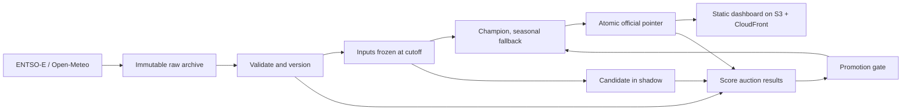

# Design

How the forecasting system is built and why. Results are in the
[README](../README.md), day-to-day operation in [OPERATIONS.md](OPERATIONS.md) and
the source checks in [SOURCE_AUDIT.md](SOURCE_AUDIT.md). Frozen configs and
reports, pinned by checksum, refer to this document by its earlier name, PLAN.md.

## Scope

The system publishes a forecast of tomorrow's Austrian day-ahead electricity
prices every day before the auction, keeps exactly what it knew when it did so,
and scores every forecast once the auction result is out. The evidence it aims for
is a running service, reproducible backtests, an honest comparison with simple
baselines and documented recovery from failures. A baseline that stays champion
is an acceptable result; model improvement is measured, not promised.

Out of scope: trading, intraday forecasts, other target countries, paid commodity
data, Kubernetes, streaming infrastructure and a feature store.

## Forecast contract and market calendar

**Target.** The Austrian SDAC day-ahead auction price in EUR/MWh, bidding zone
`10YAT-APG------L`. ENTSO-E can return two overlapping Austrian auction series;
the adapter selects sequence 1 (see the source audit).

**Resolution.** SDAC moved to 15-minute products on delivery day 2025-10-01 [S1].
Production forecasts native quarter-hours. Two research tracks stay separate:

1. Hourly long history: Austrian prices from 2018-10-01, with later quarter-hours
   aggregated to hours. Useful for long-run seasonality and the 2022 crisis.
2. Native quarter-hours from 2025-10-01, the production track.

Old hourly prices are never expanded into four "observed" quarter-hour labels. When
a quarter-hour forecast has to fall back on hourly values, it is labelled
`hourly_derived`.

**Timing.** Times are `Europe/Vienna`, not a fixed UTC offset; the coupled auction
runs at noon local time [S4].

- Collection starts at 10:00 on D-1.
- Inputs freeze at **10:30 on D-1**; only data retrieved by then can be used.
- Publication is due by **10:45**; retries against the same inputs run until
  11:00. Later forecasts are marked late and count against on-time performance.
- An official forecast is never backdated or replaced. Experimental runs are
  separate artifacts.

`cutoff_at`, `issued_at` and `published_at` are stored separately in UTC. The
delivery grid runs between consecutive Vienna midnights as half-open UTC intervals:
92, 96 or 100 quarter-hours (23, 24 or 25 hours). Each interval stores start, end,
duration, local date, local clock time, UTC offset and DST fold; an interval is never
identified by local clock time alone.

## Point-in-time data rules

A forecast for delivery day D may use D-1 auction prices only if they were
published and retrieved before the cutoff. Prices for D, observed weather, load or
generation for D, and neighbouring zones' prices for D are all excluded. Calendar
features are known in advance.

Each source observation keeps its source, area, variable, unit, valid interval and
resolution; the document or run identifier, revision and model initialisation time
where supplied; publication time where meaningful, `retrieved_at` and
`first_seen_at`; the raw object checksum and an availability class:

- **Verified vintage:** an archived version with evidence that it existed before
  the cutoff.
- **Reconstructed:** historical values with timing assumptions but no original
  vintage. Fine for research, labelled for possible revision bias.
- **Ineligible:** no timing evidence, or known to be published after the cutoff.

Downloading history today does not show when it first appeared, so retrospective
backtests disclose that revisions may be present. The live archive, collected
before each cutoff, is the strongest evidence.

ENTSO-E's "day-ahead" label does not prove pre-auction availability, and its
responses carry no publication time. Load and wind/solar forecasts are therefore
collected prospectively and their first-seen times logged before they can become
features. Open-Meteo's Historical Forecast API stitches successive runs [S2], so
it does not represent a forecast available at a fixed cutoff; weather comes from
archived single runs instead [S3].

## Sources and validation

**ENTSO-E.** The token is read from `ENTSOE_API_KEY`; request URLs carry it, so
they are never logged. Prices are archived per delivery day: original responses are
kept immutably with a manifest and checksums, overlapping downloads normalise
idempotently, and recent days are re-downloaded daily to catch revisions. Both
original and corrected versions are kept, so a past forecast's inputs never change.
Requests use timeouts and bounded backoff, and authentication, throttling, no-data,
malformed responses and server errors are distinguished [S5].

**Optional inputs**, each adopted only after an ablation on the same windows:

- Lagged DE-LU prices (tested; no gain, not adopted).
- Austrian load and renewable forecasts, after their availability is shown.
- ECMWF weather for Vienna, Graz, Linz, Salzburg, Innsbruck and Eisenstadt:
  temperature, 100 m wind and solar radiation, as regional proxies rather than a
  capacity-weighted grid.
- Gas and CO₂ prices are left out; good data is paid.

**Validation.** Hard failures: invalid timestamps, conflicting records without a
version rule, wrong units or zone, a broken interval grid, missing labels in a day
claimed complete, future information in features, non-finite predictions. Negative
and extreme prices are real market outcomes and are never clipped. Missing labels
are never interpolated for evaluation. If no complete baseline can be built from
eligible history, the system publishes an "unavailable" status instead of a curve.

## Storage

Raw responses, versions, forecasts, scores and operational records are JSON files
written atomically, with checksums. All writers share one OS file lock, so only
one job writes at a time. A database (PostgreSQL) would come in only when a second
service needs to write concurrently.

- One official forecast per delivery day, behind an atomically written pointer
  (`official/YYYY-MM-DD.json`); shadow and diagnostic forecasts live elsewhere.
- Each forecast records its input checksums, code and lock-file hashes, cutoff,
  issue time, source slots, model and fallback use.
- Scores pin the actual-price snapshot they used; a later revision creates a new
  score and leaves the old one intact.

## Models

**Baselines.** Prior-day, prior-week and a trailing same-weekday median, matched by
local clock slot rather than a UTC shift. Across DST the matching fold is used when
present, otherwise the only matching slot, otherwise the latest eligible match
within 28 days; fallbacks are recorded. Production has used the prior-day baseline
(`seasonal-daily-v1`) since delivery day 2026-10-16, after it beat the weekly one on
both validation eras; the weekly baseline stays the reference for skill.

**Features** (`features.py`): local hour and quarter, weekday, weekend, Austrian
holidays, annual seasonality, DST offset, D-1/D-2/D-7/D-14 matching-slot prices and
trailing statistics from available values only. Any scaling, selection or
calibration is fitted on training data only.

**Learned models.** Ridge regression and pooled LightGBM with an MAE objective,
each with a 180-day and an expanding training window. For uncertainty, P10/P50/P90
quantile models, conformally calibrated on held-back training days, and a
past-error interval for ridge. Production ridge (`ridge.py`) is plain numpy so the
serving image needs no scikit-learn.

## Evaluation and promotion

**Windows** are frozen before any model is selected (`configs/splits.json`). All
intervals of a delivery day fall in the same fold. Each backtest day simulates one
cutoff and trains only on labels available then, refitting weekly as operation does.

- Hourly: training 2018-10 to 2020, validation 2021–2023, holdout 2024; 2022 is
  reported as a stress period.
- Native: training 2025-10 to 2026-03, validation April–June 2026, holdout
  July–August 2026. September 2026 onward is prospective evidence.
- 2025-10-26, 2026-03-29 and the 2025-09-30/10-01 resolution change are fixed
  test cases.

**Metrics.** MAE, RMSE, MAE skill against the weekly baseline, pinball loss per
quantile, 80% interval coverage and width, with breakdowns by time of day, weekday,
and extreme and negative prices. No MAPE: prices can be zero or negative.
Uncertainty in model differences comes from a week-block bootstrap of paired daily
losses, since quarter-hours within a day are not independent. A holdout is consulted
once; after that, only fresh forward windows count.

**Promotion gate** (`promotion.py`; engineering defaults, not scientific constants).
The candidate runs in shadow beside the official forecast and is promoted
automatically, from the next publication, when all of these hold on the same days:

- at least 28 common days, at least 14 of them live shadow days;
- MAE at least 2% below the champion and below the weekly baseline;
- the 95% week-block interval of the daily MAE difference entirely below zero;
- RMSE no more than 5% above the champion.

If a promoted model fails at publication, the seasonal baseline is published and
the pointer records the fallback. Rollback restores the previous champion and
blocks the demoted version; only a new version can be promoted again.

Pull-request CI uses small deterministic fixtures. Network tests are opt-in, and
model evaluation runs on the archive, not on live APIs in CI.

## Operation and deployment

One EC2 instance runs the batch jobs as one-shot Docker containers started by
systemd timers in Vienna time; GitHub Actions runs CI and builds the image but is
not the deadline-sensitive scheduler. Jobs are separate (collect, publish, settle,
watchdog, dashboard), take the writer lock and retry within bounds. The host has no
inbound ports and is managed through SSM; the API token lives in SSM Parameter
Store and is on disk only while a job runs. Data is backed up nightly to S3.

The dashboard is a static export of public fields only: official forecasts, actual
prices, errors, job status and the model comparison. It is uploaded to S3 behind
CloudFront after each job and marks itself stale when exports stop.

## Key decisions

- **Native 15-minute target, hourly history kept separate.** Native history is
  short, but expanding hourly prices into quarter-hours would invent observations.
- **A fixed 10:30 cutoff.** It is a project choice, not a market rule, and may move
  later for data availability, but it stays before the 12:00 gate closure.
- **Evidence classes for every input.** A value counts only if it can be shown to
  have existed before the cutoff, so no backtest quietly uses data the live system
  would not have had.
- **JSON files and one lock instead of a database.** One job writes at a time, so
  a database adds operations work without solving a real problem yet.
- **A static dashboard instead of an API.** The dashboard already publishes its data
  as JSON; a documented API waits until someone needs forecasts programmatically.
- **Images built once in CI, pulled by digest.** The host never builds; what runs is
  exactly what CI tested, and rollback is repointing a digest.
- **Ridge as the first learned candidate.** On validation it beat LightGBM on
  core features (26.49 vs 27.20 EUR/MWh) and was frozen before the holdout was used.
- **Automatic promotion.** Promotion follows the gate without a manual approval
  step; the seasonal fallback and rollback limit the damage of a bad model.
- **Past weather forecasts as training inputs.** Archived ECMWF runs (never
  observed weather) may train models; the published ECMWF schedule counts as
  availability evidence, and prospective logging keeps checking it.
- **DE-LU prices not adopted.** They changed validation MAE by at most 0.08 EUR/MWh;
  Austrian price lags already carry the information.

## References

Checked 2026-09-14.

- [S1: ENTSO-E Single Day-Ahead Coupling](https://www.entsoe.eu/network_codes/cacm/implementation/sdac/)
  — quarter-hour transition and Austrian bidding-zone history.
- [S2: Open-Meteo Historical Forecast API](https://open-meteo.com/en/docs/historical-forecast-api)
  — stitched historical output and how it differs from individual model runs.
- [S3: Open-Meteo Previous Runs API](https://open-meteo.com/en/docs/previous-runs-api)
  — lead-time offsets, model coverage and single-run selection.
- [S4: EPEX SPOT trading brochure](https://www.epexspot.com/sites/default/files/2024-09/Trading%20Brochure%202024%20August.pdf)
  — the noon coupled-auction timeline.
- [S5: ENTSO-E data extraction implementation guide](https://transparency.entsoe.eu/content/static_content/download?path=%2FStatic+content%2Fweb+api%2FIG-for-TP-data-extraction-process.pdf)
  — request document types and extraction protocol.
